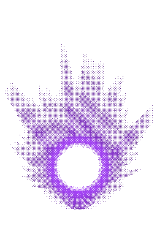
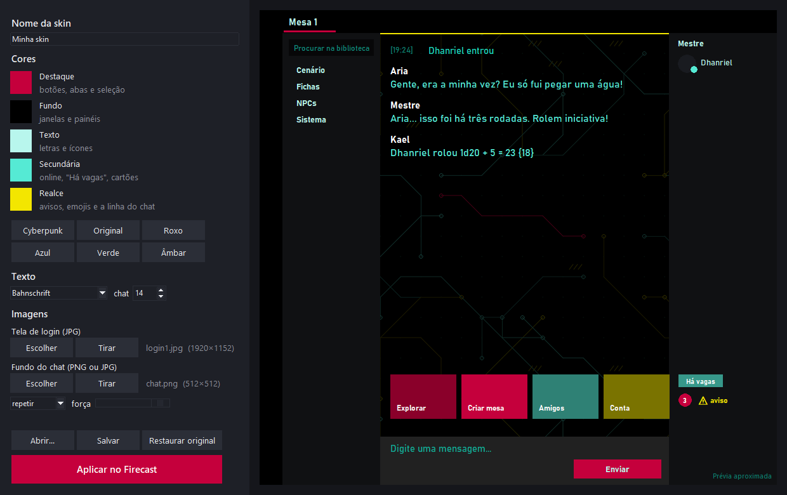

# Firecast Plus

Plugin + ajudante para o **RRPG Firecast 8**: mais funções, skins de cores, aura animada nos tokens e mais.
Usa só o SDK oficial de plugins e arquivos locais. Não mexe no protocolo nem no servidor.



## Instalar

1. Baixe o `FirecastPlus-<versão>.zip` na página **Releases** e extraia.
2. Feche o Firecast (inclusive o ícone perto do relógio).
3. Dê dois cliques em `instalar.bat`. Ele completa o plugin com arquivos do seu próprio Firecast (o SDK e o som de
   menção) e o instala em `%APPDATA%\Firecast\Plugins`.
4. O instalador pergunta se você quer o **ajudante**, que usa Python 3. Se responder sim, ele cria o atalho
   **Firecast Plus** na área de trabalho. Abra o Firecast sempre por esse atalho.
   Se o Python não estiver instalado, o instalador oferece baixar o Python 3.12 do python.org (só para o seu usuário,
   uns 25 MB). Ele confere a assinatura digital da Python Software Foundation antes de instalar.
   Se um ajudante de uma versão anterior estiver aberto, o instalador o fecha, para o atalho abrir o novo.

O ajudante é necessário para:
- trocar as cores e a fonte do Firecast e aumentar o texto do chat;
- piscar o ícone por mesa ou aba;
- reaplicar a skin depois de uma atualização do Firecast.

As outras funções funcionam só com o plugin.

## Editor de Skins



O atalho **Editor de Skins Firecast Plus** abre uma janela para montar a sua própria skin, sem mexer em código:
- cinco cores: destaque, fundo, texto, secundária e realce, com presets (Cyberpunk, Original, Roxo, Azul...);
- a fonte do programa e o tamanho do texto do chat;
- uma imagem para a tela de login (JPG) e outra para o fundo do chat (PNG ou JPG), que pode repetir, esticar ou
  ficar no centro, com um controle de força para o texto continuar legível;
- uma prévia ao lado, que muda na hora.

**Salvar** grava `skins/<nome>.json` e a pasta `skins/<nome>/`; para compartilhar a skin, mande os dois.
**Aplicar no Firecast** fecha e reabre o Firecast já com a skin, e **Restaurar original** volta o tema de fábrica.
Também abre direto com `python editor_skins.py`.

## Personalização visual e Termos de Uso

As funções do plugin usam só o SDK oficial, que os Termos do Firecast autorizam (item 12.3c).

A troca de **cores, fonte, tamanho do chat e imagens da skin** é diferente: o ajudante reescreve, no seu PC, o arquivo de tema
`%LOCALAPPDATA%\Firecast\resource.zip`. Ele não altera o `Firecast.exe`, o protocolo, o servidor nem o login, guarda
um backup do original e volta tudo com **Restaurar original** (ou `python fcplus.py restaurar`).
Mesmo assim, o item 4.2(c) dos Termos proíbe "utilizar qualquer software Firecast não autorizados ou modificados", e
não há autorização expressa para esse tipo de personalização. Por isso ela é **opcional**: só funciona com o ajudante
instalado, e o resto do plugin não depende dela. Use por sua conta. Se o Grupo RRPG Firecast se manifestar contra,
ela sai do projeto.

## Comandos e botões

| Onde | O quê |
|---|---|
| `/fc` | lista os comandos |
| `/cores` ou botão no chat | cores do Firecast (destaque, fundo e texto, com presets), fonte do programa e tamanho do texto do chat. O preset **Cyberpunk** (preto, vermelho, amarelo e verde-água) também põe imagens no chat e na tela de login. **Aplicar e reiniciar** reinicia o Firecast já com tudo novo |
| `/beep` ou botão no chat | palavras que tocam um beep quando alguém as escreve. Ignora maiúsculas e acentos, e as suas próprias mensagens |
| `/piscar` ou botão no chat | escolhe por mesa e por aba quem faz o ícone piscar na barra de tarefas. Desligue antes o "Piscar" nativo em Configurações > Notificações |
| `/previa` ou botão no chat | liga ou desliga a prévia de imagens e de vídeos do YouTube logo abaixo das mensagens. Só quem tem o plugin vê |
| `/turno` | rastreador de iniciativa. O mestre monta a ordem e avança o turno; o jogador da vez recebe beep e um aviso |
| `/multi N rolagem [texto]` | rola a mesma rolagem N vezes |
| `/sorteio [texto]` | sorteia um jogador da mesa |
| `/timer segundos [texto]` | lembrete que só você vê |
| Mapa > Firecast Plus > **Meu token** | cria o seu token (avatar e nick) onde você clicar. Um por pessoa |
| Mapa > Firecast Plus > **Remover meu token** | remove o token criado pelo plugin |
| Mapa > Firecast Plus > **Aura** | aura animada em chamas atrás do token selecionado, com cor, tamanho e intensidade. Todos veem, até quem não tem o plugin |

**Token e aura:**
- O jogador só mexe no próprio token. O mestre mexe em qualquer um.
- Quando o Firecast não deixa o jogador agir direto, o pedido vai ao plugin do mestre. Para isso, o mestre precisa ter o plugin e estar no mapa.

## Linha de comando (`fcplus.py`)

```
python fcplus.py plugin            monta plugin/ em dist/ e instala
python fcplus.py skin skins/X.json aplica uma skin (Firecast fechado)
python fcplus.py restaurar         volta o tema original
python fcplus.py paleta            mostra as cores do tema
python fcplus.py iniciar           abre o Firecast com o ajudante (é o que o atalho faz)
python fcplus.py atalho            cria o atalho na área de trabalho
python fcplus.py pacote            monta o zip de distribuição em dist/ (sem instalar)
python gerar_aura.py               gera o GIF da aura (precisa de Pillow e numpy)
python gerar_cyberpunk.py          gera as imagens da skin Cyberpunk (precisa de Pillow e numpy)
python editor_skins.py             abre o Editor de Skins (--teste roda o autoteste)
```

Uma skin é um JSON com `base` (`destaque`, `fundo`, `texto`), de onde os tons são derivados, e/ou `cores`
(chaves da paleta para `#RRGGBB`). Opcionais: `fonte` (o nome de uma fonte instalada no Windows, no lugar de Roboto e Lato) e
`tamanho_chat` (10 a 40; o normal é 14). Veja `skins/roxo.json`.

Uma skin também pode trocar arquivos do tema com `arquivos`: o caminho dentro do `resource.zip` aponta para um arquivo
da pasta `skins/` (uma imagem ou um frame em XML), ou para `null`, que apaga a entrada. Veja `skins/cyberpunk.json`:
ela troca os fundos da tela de login e põe um padrão de circuito atrás das mensagens do chat. As imagens são arte
original, geradas pelo `gerar_cyberpunk.py`.

## Testes

```
python test_fcplus.py      skins e reaplicação após atualização (numa cópia do resource.zip)
python test_modulos.py     autotestes da prévia de links e do turno, na Lua do próprio Firecast
python check_lua.py        sintaxe de todos os .lua/.dlua do plugin
python editor_skins.py --teste   o editor monta uma skin completa numa pasta temporária
```

## Licença

MIT (veja `LICENSE`). O repositório e o download não trazem nenhum arquivo do Firecast: na instalação, o
`instalar.ps1` copia do Firecast já instalado no PC o SDK Lua (que todo plugin precisa levar) e o som de menção.
